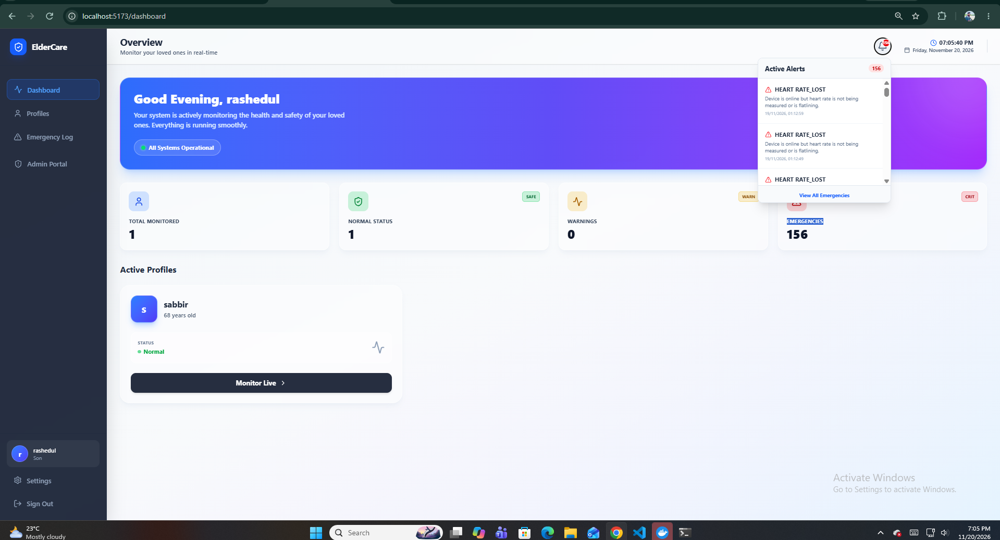
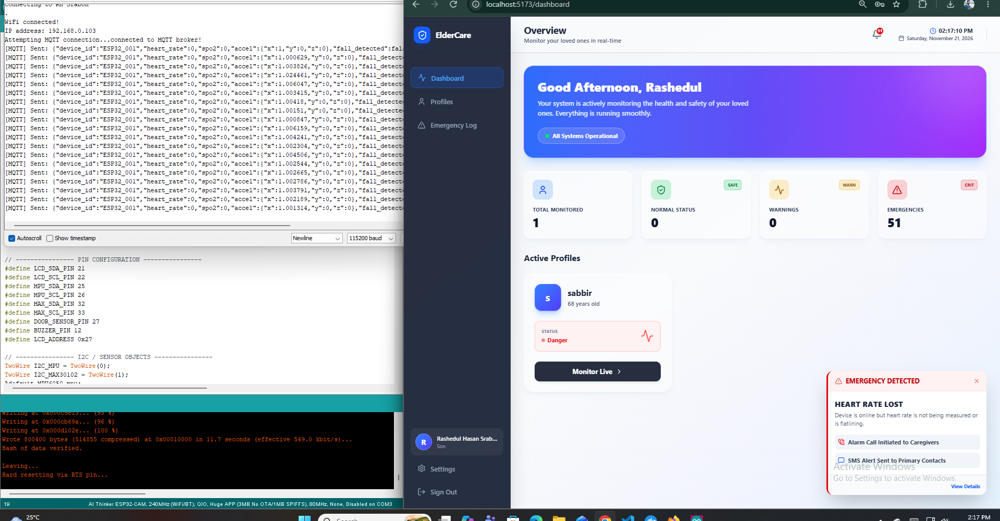
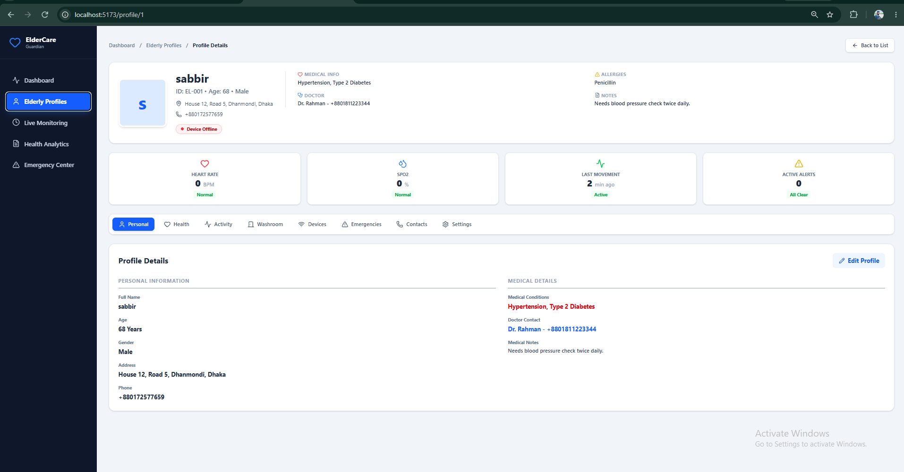
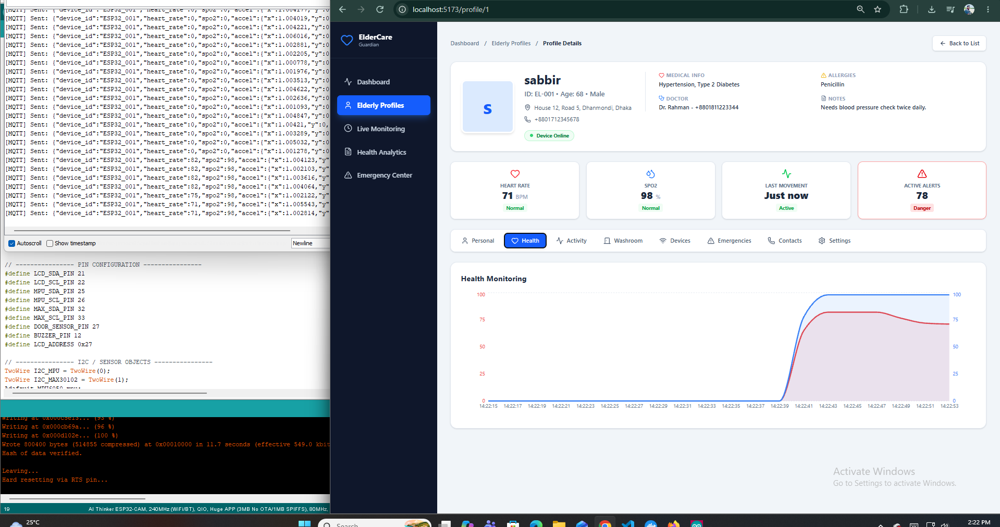
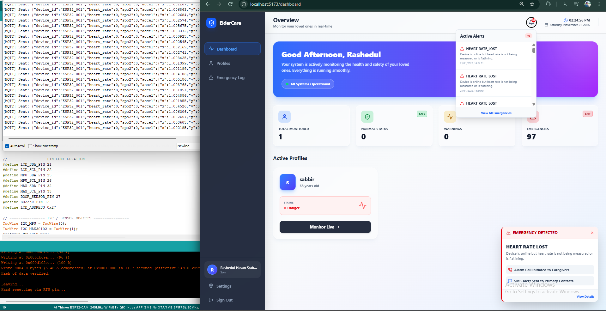
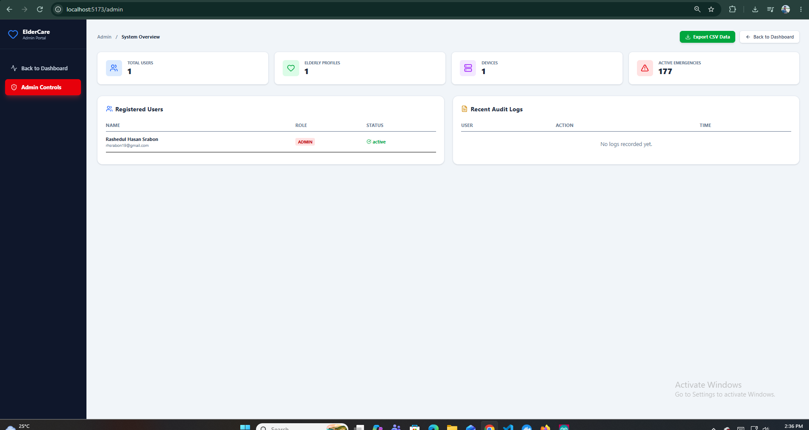
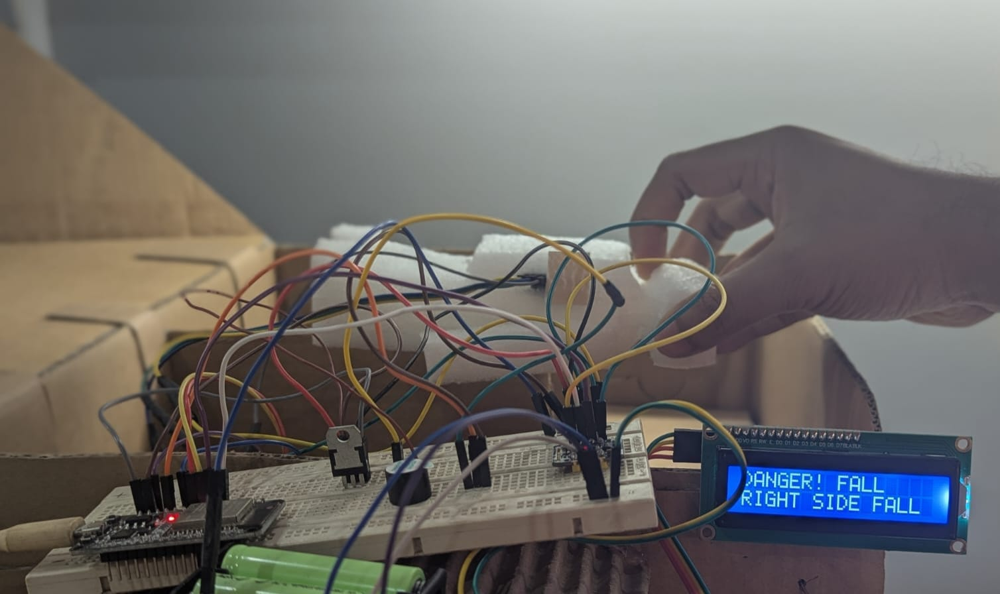
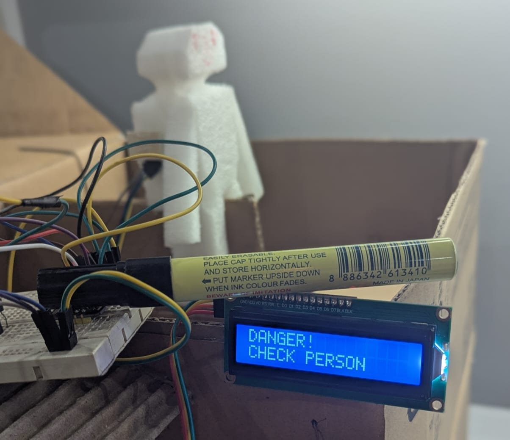
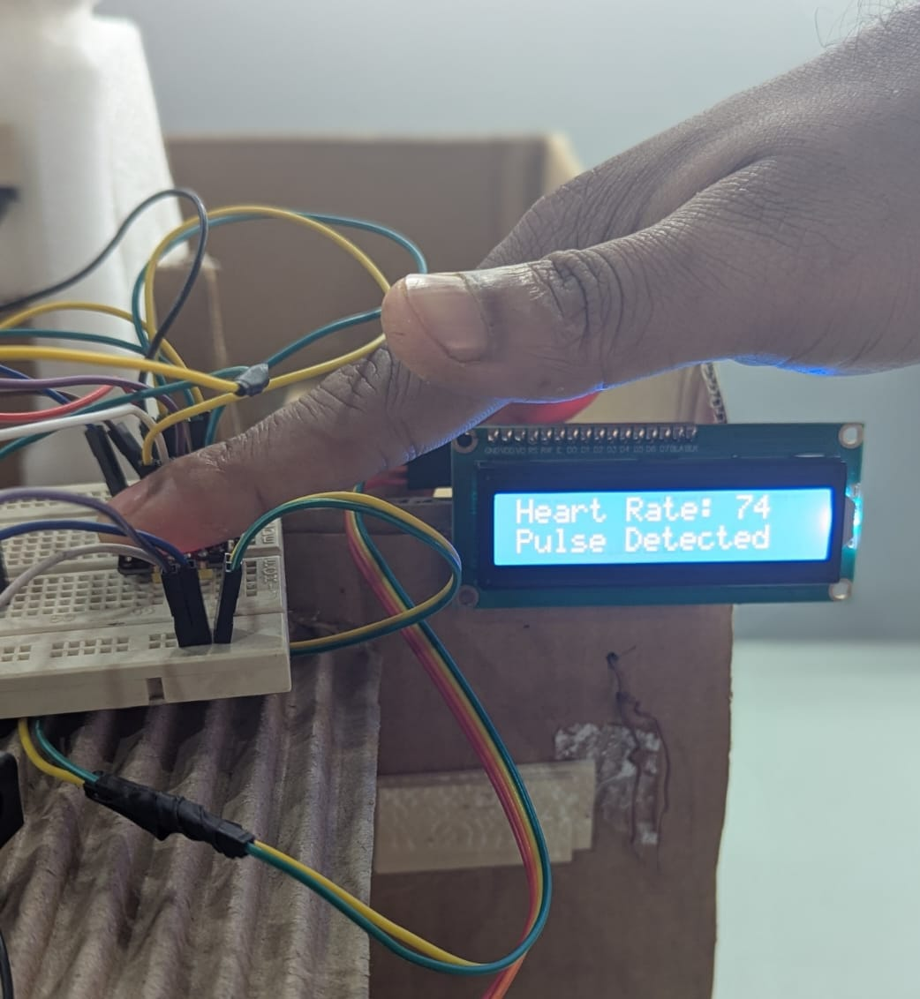
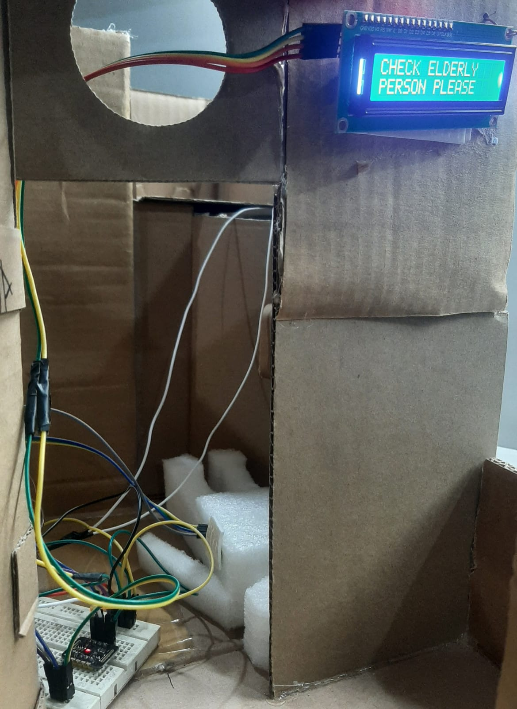

# 🏥 ElderSafe: IoT Full-Stack Elder Monitoring System

An end-to-end IoT system designed to monitor the health and safety of elderly individuals in real-time, featuring fall detection, heart rate monitoring, washroom occupancy tracking, and automated multi-channel emergency escalation.

## 📸 Project Showcase

### 💻 Software Dashboard
*Here are the key features of the live React dashboard and real-time alerts.*

**Dashboard & Notification Bell:**

**Profile & Health Analytics:**

**Real SMS Alerts on Phone:**

### 🔌 Hardware Prototype
*The physical ESP32 integration with the three sensors.*

**ESP32 Setup:**

---

## 🛠 Tech Stack
- **Hardware:** ESP32, MPU6050 (Fall), MAX30102 (Heart Rate), MC-38 (Door)
- **Backend:** FastAPI, PostgreSQL, SQLAlchemy, Mosquitto MQTT, TextBee (SMS)
- **Frontend:** React, TypeScript, Tailwind CSS, Recharts, React Query

## 🚀 How to Run Locally
1. Clone this repository.
2. Create a `.env` file based on `.env.example`.
3. Run `docker compose up --build -d`.
4. Access the dashboard at `http://localhost:5173`.
5. Access the API docs at `http://localhost:8000/docs`.
